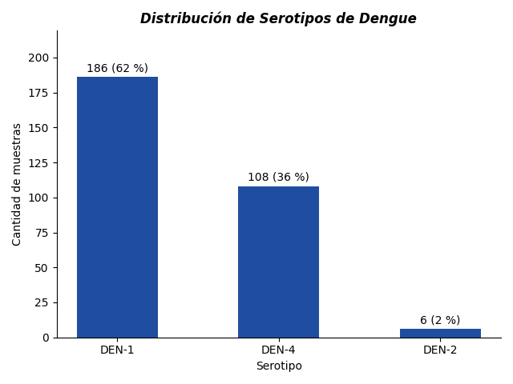
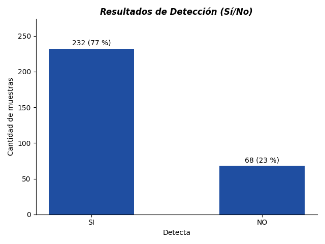

# Análisis categórico de datos de Dengue

Análisis exploratorio de un dataset categórico de Dengue: 300 muestras descritas por dos
variables, si el virus se detectó o no y a qué serotipo corresponde. Es mi primer proyecto
dentro de mi portafolio en GitHub, orientado a virología, genética y bioinformática.

Autora: **Rocío Sandez**.

## Los datos

El dataset lo provee la cátedra de Bioestadística. Tiene 300 filas y dos variables
categóricas, `Detecta` (SI / NO) y `Serotipo` (DEN-1, DEN-2, DEN-4). Cruzadas, dan esta
tabla de contingencia:

| Detecta | DEN-1 | DEN-2 | DEN-4 | Total |
|---|---|---|---|---|
| **SI** | 133 | 0 | 99 | 232 |
| **NO** | 53 | 6 | 9 | 68 |
| **Total** | 186 | 6 | 108 | 300 |

El serotipo más frecuente es DEN-1 (186 muestras, 62 %), seguido de DEN-4 (108, 36 %);
DEN-2 aparece apenas 6 veces. En cuanto a la detección, la mayoría de las muestras dieron
positivo: 232 de 300, el 77 %.

## Gráficos





## Qué practiqué

- Organización de datos biológicos.
- Análisis descriptivo.
- Gráficos de distribución de categorías.
- Armado e interpretación de tablas de contingencia.

## Cómo reproducirlo

El análisis completo está en
[`notebooks/analisis_dengue.ipynb`](notebooks/analisis_dengue.ipynb): lee el dataset, arma
la tabla de contingencia, genera los dos gráficos de más arriba y corre las pruebas de
independencia. GitHub lo muestra ya ejecutado, con todas las salidas, así que se puede leer
sin instalar nada.

Para correrlo:

```bash
pip install -r requirements.txt
jupyter notebook notebooks/analisis_dengue.ipynb
```

## Estructura

```
dengue_clase2.txt   el dataset, 300 filas separadas por tabulaciones
notebooks/          el análisis (analisis_dengue.ipynb) y el informe original en PDF
images/             los gráficos, generados por el notebook
```

## Informe

- [Tablas de contingencia](notebooks/Tablas%20de%20contingencia.pdf)
- [Conclusiones del análisis](notebooks/Conclusiones%20del%20an%C3%A1lisis.pdf)

## Nota de corrección

El informe [Conclusiones del análisis](notebooks/Conclusiones%20del%20an%C3%A1lisis.pdf)
dice que la tabla de contingencia no evidencia un patrón marcado entre el serotipo y la
detección. Revisando los datos, esa lectura no se sostiene, y las frecuencias relativas por
fila de la propia tabla ya lo mostraban:

| Serotipo | Muestras | Detección positiva |
|---|---|---|
| DEN-1 | 186 | 133 (72 %) |
| DEN-2 | 6 | 0 (0 %) |
| DEN-4 | 108 | 99 (92 %) |

La diferencia entre esas tasas es estadísticamente significativa: χ² = 36,7 con 2 grados de
libertad, p ≈ 1 × 10⁻⁸. Como la fila de DEN-2 tiene una frecuencia esperada de 1,4, por
debajo del mínimo de 5 que pide la prueba de χ², repetí el contraste sólo entre DEN-1 y
DEN-4 con la prueba exacta de Fisher: OR = 0,23, p ≈ 2,6 × 10⁻⁵. La asociación se mantiene.

Vale aclarar qué *no* dice esto. Son datos de una práctica, no de un estudio
epidemiológico, y una tasa de detección distinta según el serotipo puede deberse al método
de detección o a cómo se armó la muestra, antes que a la biología del virus. El caso de
DEN-2 son 6 muestras: con tan pocas, cero positivos no alcanza para concluir nada.

Dejo el informe original sin modificar y esta nota como corrección. Los gráficos de más
arriba también se rehicieron a partir del dataset: los anteriores graficaban la suma de los
números de fila de cada categoría en lugar de las frecuencias.
